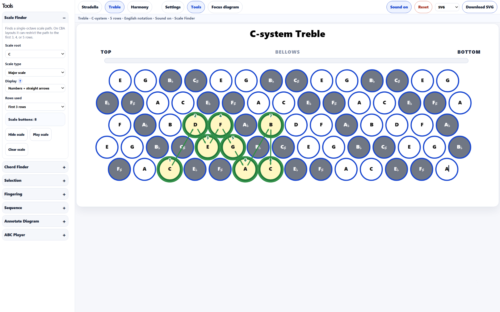
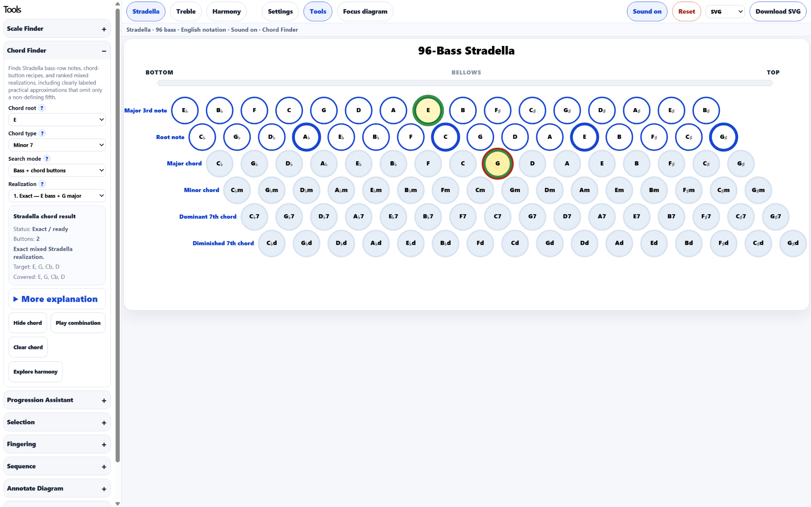
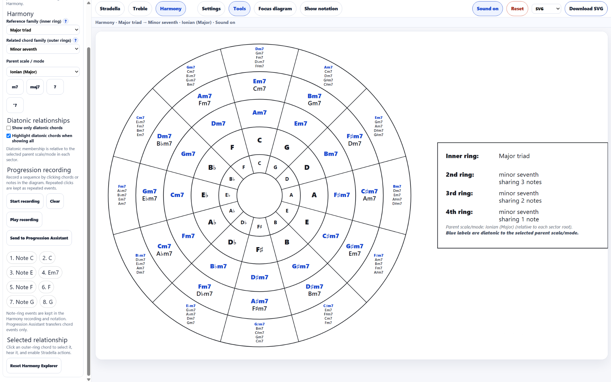
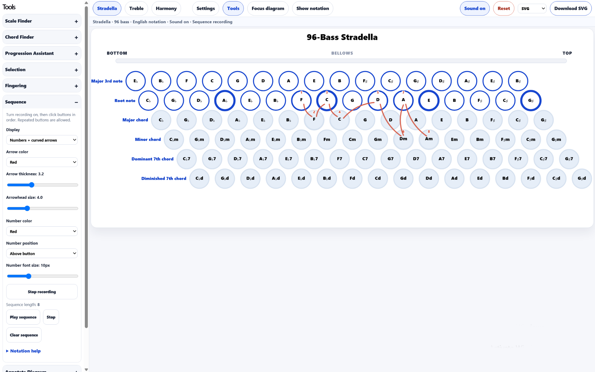
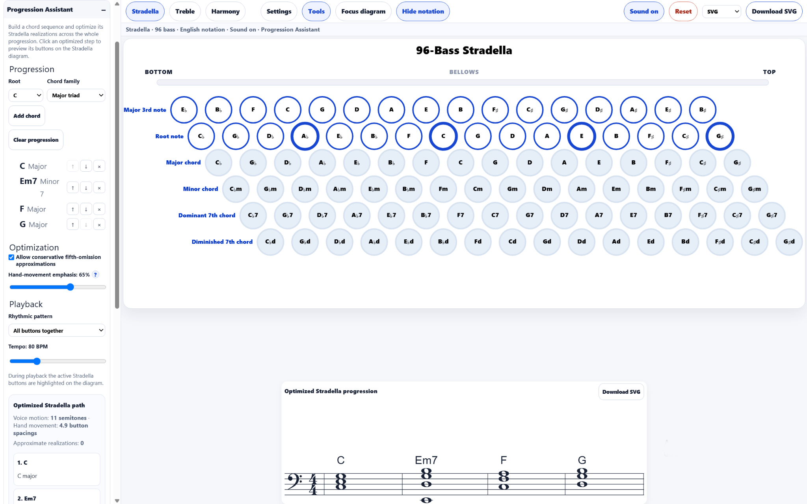

# Accordion-Tools

**Accordion-Tools** is a browser-based collection of interactive tools for accordion players, students, and teachers. It combines configurable Stradella and treble diagrams with scale and chord exploration, harmonic analysis, fingering and sequence tools, accompaniment patterns, audio playback, music notation, and SVG/PNG export.

Current version: **0.15.6**

Historical validation: [Stradella configuration matrix](docs/internal/validation.md) (offline test evidence and limitations; not a verified production build).

**Live site:** https://gilsag.github.io/Accordion-Tools/

## Highlights

- Stradella bass diagrams from compact layouts up to 120 bass.
- C-system, B-system/Bayan, and piano treble layouts.
- Scale Finder and Chord Finder for treble and Stradella.
- Stradella chord realizations using chord buttons, bass/counterbass buttons, or mixed combinations, with ergonomic ranking and conservative approximations.
- Harmony Explorer for common-tone relationships, diatonic harmony, chord families, voice leading, and progression recording.
- Stradella Progression Assistant for optimizing chord realizations across a complete progression.
- Sequence, Fingering, Selection, and diagram-annotation tools.
- Stradella Bass Pattern Player with notation and accompaniment patterns.
- ABC playback and diagram highlighting.
- Synthesized sound plus optional **La Melodiosa** sampled accordion playback.
- Music notation and SVG/PNG export.

## Screenshots

### Treble Scale Finder



Scale visualization and fingering paths on a chromatic button accordion treble layout.

### Stradella Chord Finder



The Chord Finder compares practical exact and approximate Stradella realizations using chord buttons, bass/counterbass notes, or both. It ranks realizations by button count, geometric compactness, and harmonic omissions, and highlights up to three contrasting recommended voicings for extended chords. The expanded **More explanation** describes each selected realization, including octave compression on Stradella and the effect of omitted tones. Exported diagrams can be labeled with the chord, realization type, sounding tones, and any omissions. The screenshot shows **Em7** realized as **E counterbass + G major**.

### Harmony Explorer



Explore relationships between chord families around the circle of fifths. Relationships can be filtered or highlighted according to a selected parent scale or mode, and chord/note clicks can be recorded as a progression.

### Stradella Sequence Tool



Create ordered button paths using numbers and arrows for exercises, bass movement, fingering ideas, and teaching diagrams.

### Progression Assistant



Optimize Stradella realizations across an entire chord progression, balancing harmonic voice movement and physical button movement. The assistant supports playback, accompaniment patterns, button highlighting, and staff notation.

For contributors and maintainers, see the [Developer Guide](docs/internal/developer-guide.md) for the source architecture, musical and registral assumptions, physical-button invariants, and validation checks.

## Main workspaces

### Stradella

Generate and interact with common Stradella bass layouts. Depending on the selected layout, diagrams include fundamental bass, counterbass, major, minor, dominant-seventh, and diminished-seventh rows.

Important Stradella tools include:

- **Chord Finder** — ranked exact and conservative approximate realizations, with optional diagram labels and title-based SVG/PNG filenames.
- **Progression Assistant** — whole-progression optimization and accompaniment playback.
- **Bass Pattern Player** — reusable Stradella accompaniment patterns and progressions.
- **Scale Finder** — scale paths using bass and counterbass notes.
- **Sequence** — ordered button paths with numbers and arrows.

### Treble

Treble diagrams support:

- C-system chromatic button accordion.
- B-system / Bayan.
- 3-, 4-, and 5-row layouts.
- Piano keyboard layouts.

Scale and chord tools share the same configurable notation and diagram system.

### Harmony

The Harmony Explorer provides circular diagrams of relationships between a selectable reference chord family and related chord families.

Features include:

- common-tone grouping by ring;
- diatonic-only and highlighted-diatonic views;
- selectable parent scales and modes;
- optional inner note ring;
- chord-tone tooltips and Roman numerals;
- voice-leading information;
- chord-family highlighting;
- progression recording from chord and note clicks;
- playback and notation of recorded sequences;
- direct handoff of chord progressions to the Stradella Progression Assistant.

## Sound

Accordion-Tools includes a lightweight synthesized sound engine and optional playback using the **La Melodiosa** accordion sample set.

**La Melodiosa** was sampled, edited, and originally programmed by **Petri Pohjanmies (Finland), 2026** and is used under the Creative Commons Attribution (CC-BY) license. The original attribution and instrument-definition files are retained with the samples in `public/samples/la-melodiosa/`.

## Documentation

Detailed documentation is available in the [`docs/`](docs/) folder, including guides for:

- [Settings](docs/settings.md)
- [Scale Finder](docs/scale-finder.md)
- [Chord Finder](docs/chord-finder.md)
- [Harmony Explorer](docs/harmony-explorer.md)
- [Progression Assistant](docs/progression-assistant.md)
- [Selection Tool](docs/selection-tool.md)
- [Fingering Tool](docs/fingering-tool.md)
- [Sequence Tool](docs/sequence-tool.md)
- [Annotate Diagram](docs/annotate-diagram-tool.md)
- [ABC Player](docs/abc-player.md)
- [Bass Pattern Player](docs/bass-pattern-player.md)
- [Bass Pattern format](docs/bass-pattern-format.md)

## Running locally

Accordion-Tools uses React, TypeScript, Vite, and npm.

```bash
npm install
npm run dev
```

Vite will display the local address, normally something similar to:

```text
http://localhost:5173/
```

To test the production build:

```bash
npm run build
npm run preview
```

## Export

Diagrams can be exported as **SVG** or **PNG**. Several tools also provide dedicated notation or music-data exports.

## Acknowledgements

The development of the Stradella Chord Finder was informed in part by the [Stradella Explorer](https://accordionchords.com/stradella-bass-chord-calculator-interactive-stacking-engine/) at AccordionChords.com, which provided a useful reference for exploring practical chord realizations on the Stradella bass system.

Thanks also to **Petri Pohjanmies** for making the La Melodiosa sample set available under CC-BY.

## License

See [`LICENSE`](LICENSE) for the license applying to Accordion-Tools. Third-party assets, including La Melodiosa, retain their own licensing and attribution terms.


### Reading the documentation in the app

Choose **Settings → About → Open documentation** to browse the bundled guides with topic navigation and search, without leaving the application. The GitHub README remains available through the existing link.

### Contextual chord and scale diagrams

**Settings → Title → Contextual** (the default) uses the selected chord or scale in diagram titles, including Stradella realization status and relevant nominal non-root lowest tones, and the selected inversion and realization status on Treble. Major and minor chords use explicit names (`Cmaj`, `Cmin`, `Cmaj7`, `Cmin7`) so exported files are unambiguous. Extended chords now include dominant, major, and minor ninths, elevenths, and thirteenths, with recommended practical Stradella voicings and concise omission explanations. Chromatic-button treble diagrams offer one- and two-octave compact sizes alongside every existing preset; the view expands as needed to keep selected buttons visible. See [Chord Finder](docs/chord-finder.md) and [Settings](docs/settings.md).

### Stradella Chord Finder diagram notes

The brief notes under a selected Stradella chord diagram and in SVG/PNG exports can display any combination of **Harmonic identity**, **Pitch-class realization**, **Registral voicing**, and **Physical realization**. Use the four checkboxes beneath **Show realization explanation below diagram** in the Chord Finder. The expanded **More explanation** remains available independently. These preferences can be exported/imported with Settings; see [Chord Finder](docs/chord-finder.md) and [Settings](docs/settings.md).


### La Melodiosa register-following playback

Stradella sound can now follow the configurable nominal bass/counterbass and preset-chord octave ranges using La Melodiosa WAV samples. Notes outside the mapped C2–B3 bass range are pitch-transposed from the nearest available sample region (no automatic synthesizer fallback). The original sample octave mapping remains selectable; the physical register I/II/III selection is independent of the nominal pitch range. See [Settings](docs/settings.md) for details, caveats about reed doublings and transposition, and configuration options.

### Stradella register interpretation and concise notes (v0.15.2)

The nominal octave/grouping settings for bass/counterbass and preset-chord buttons are located under their own **Settings → Stradella registers** section, independent from the sound-source/reed settings. In the Chord Finder, the four optional explanation lines can be selected only when **Show realization explanation below diagram** is enabled. Registral notes list the modeled pitches from low to high, including octave numbers and any repeated unisons; all diagram/export explanations are left-aligned. Help tooltips replace explanatory paragraphs. Adjacent ← / → buttons browse realizations without triggering playback. The register model is an assumption about sounding notes, not a measurement of an instrument's reeds.

### v0.15.5 highlights

- Contextual titles and the Harmonic identity note identify the selected Stradella realization with familiar slash-chord notation, e.g., **Cmin7/B♭ — Exact — 2 buttons**, instead of a technical "modeled lowest" suffix. Root-position chords need no slash.
- Four-level notes and **More explanation** use chord-aware spellings (**C–E♭–G–B♭** for Cmin7) and identify conventional triad/seventh inversions. Nominal octave numbers stay in the registral line. Harmonic root/quality remains the user's selection.
- SVG/PNG download filenames are sanitized independently: `Cmin7-over-Bflat-Exact-2buttons-Bflat-bass-C-minor.svg`, with no slash, accidental symbols, or other filesystem-sensitive characters.
- This is a presentation-only revision. Chord generation, sampled audio, register settings, and ranking are unchanged.

### v0.15.4 highlights

- Clear selected-state controls for two-way Stradella register, sound and playback choices.
- Optional, register-aware short descriptions of close voicings; modest preference adjustment without excluding valid chord combinations.
- Only one deployed copy of each La Melodiosa WAV recording, preserving sample attribution and original mapping information.
