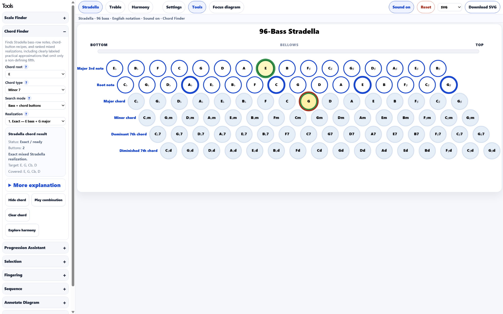
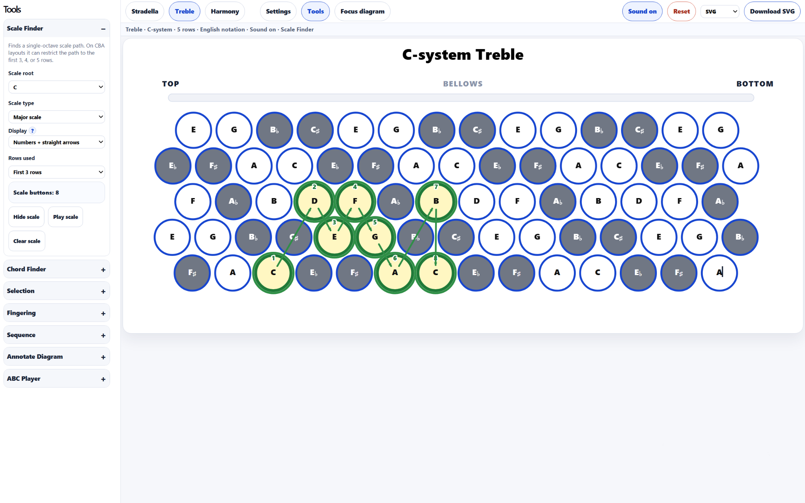
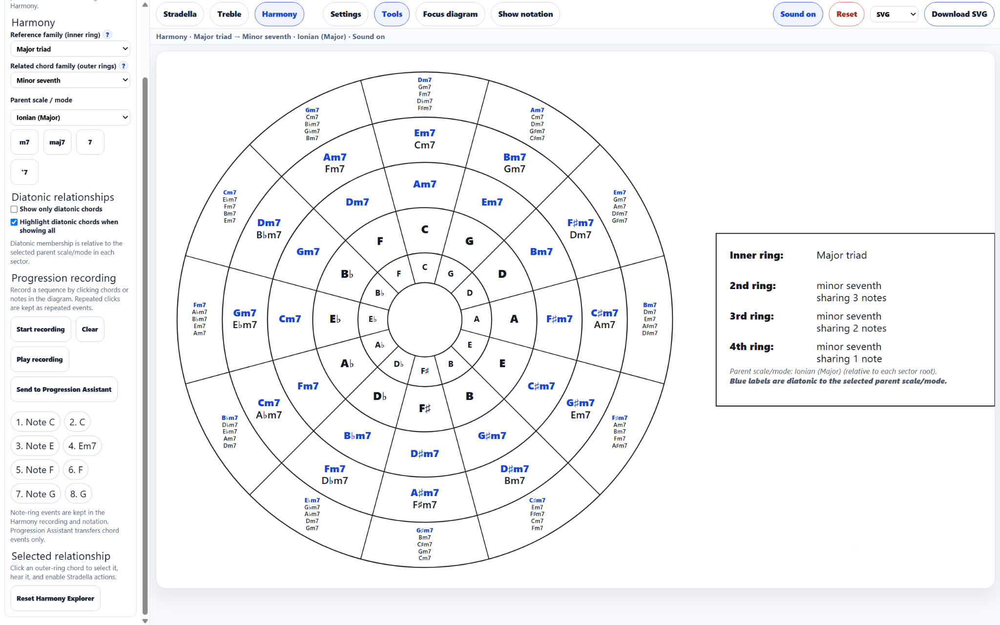
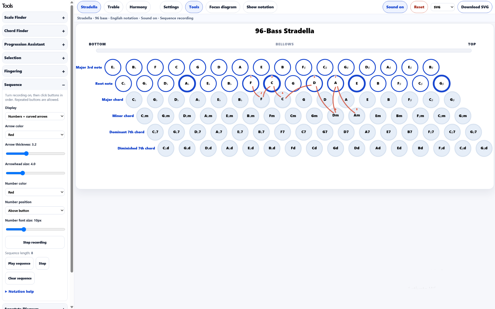
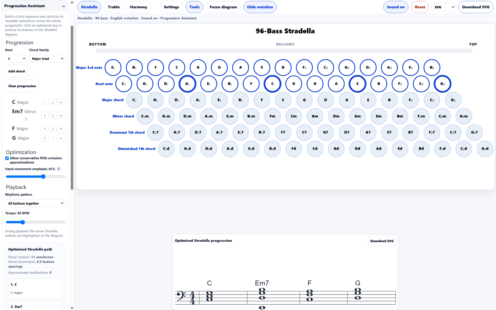

# Accordion Tools

**Explore chords, scales, harmony, and accompaniment on an interactive accordion.** Accordion Tools is a free, browser-based collection of visual and musical tools for accordion players, students, and teachers. It supports Stradella bass, C-system and B-system chromatic button accordions, and piano accordion layouts.

**[Open Accordion Tools](https://gilsag.github.io/Accordion-Tools/)** · [User guides](docs/)



*Stradella Chord Finder — **Em7** realized using **E counterbass + G major chord**. The selected physical buttons are highlighted on the diagram. The finder compares exact and conservative approximate realizations, explains omitted tones and close voicings, and can show nominal note spacing in semitones. For extended chords, its ranking considers defining tones and register density as well as completeness and ergonomics.*

## Explore, play, and create

- **Find chords and scales.** Visualize scales on either manual and compare practical Stradella chord realizations using preset chord buttons, bass/counterbass notes, or mixed combinations. The Chord Finder ranks alternatives by musical completeness, nominal register, and physical practicality, with explanations of omitted tones and voicing choices.
- **Understand harmony.** Use the Harmony Explorer's interactive circle of fifths to investigate chord families, common tones, diatonic relationships, and voice leading. Record a progression and send it to the Stradella Progression Assistant.
- **Work with progressions.** Build a sequence of chords and use the Progression Assistant to find a coherent set of Stradella realizations, balancing harmonic voice movement and hand movement. Preview the selected buttons and hear rhythmic accompaniment.
- **Practice patterns and melodies.** Use the Bass Pattern Player, ABC Player, Sequence Tool, and Fingering Tool. The ABC Player includes ready-to-use examples, including cueca floreos and a Katyusha arrangement.
- **Listen to the results.** Play individual buttons, chords, sequences, and patterns with the **La Melodiosa** accordion samples or the built-in synthesizer.
- **Create diagrams and notation.** Highlight buttons, add annotations, display staff notation where available, and export diagrams as SVG or PNG. Selected tools also support music-data or notation exports.

## More tools in action

### Treble Scale Finder



*Visualize scales directly on C-system or B-system treble diagrams and explore alternative button positions and fingering paths. The same workspace also supports piano accordion layouts.*

### Harmony Explorer



*Explore relationships between chord families around the circle of fifths, with common tones, diatonic harmony, and voice-leading information. Highlight relationships using a parent scale or mode, record chord selections, and send progressions to the Stradella Progression Assistant.*

### Stradella Sequence Tool



*Build ordered paths through physical Stradella buttons, using numbers and arrows to illustrate bass movement, fingering ideas, exercises, and teaching sequences. The resulting diagram can be exported for practice material.*

### Progression Assistant



*Optimize a series of Stradella chord realizations as a complete progression rather than selecting each chord independently. Compare harmonic voice movement with physical button movement, preview the chosen buttons, and explore playback, rhythmic accompaniment patterns, and staff notation.*

## Getting started

1. **Choose a workspace:** Stradella, Treble, or Harmony. For Stradella, choose a layout from compact configurations through 120 bass; for Treble, choose C-system, B-system/Bayan, or piano.
2. **Open a tool:** Find a chord or scale, explore a harmonic relationship, create a sequence, or load an ABC example.
3. **Experiment:** Select and listen to buttons, adjust the diagram, view notation when supported, and export the result.

The interface is available in **English, Spanish, French, Brazilian Portuguese, Italian, and German**, with browser-language detection or manual selection under **Settings → Language**. The layout also adapts to phones and tablets, offering scrollable or fit-to-screen diagram viewing. See the [Settings Guide](docs/settings.md) for details.

You can customize chord-symbol styles (for example, C/Cm or CM/Cm), instrument registers, diagram appearance, and playback settings. Settings can be saved to and loaded from JSON files.

## Documentation

- **Musical exploration:** [Scale Finder](docs/scale-finder.md), [Chord Finder](docs/chord-finder.md), [Harmony Explorer](docs/harmony-explorer.md), and [Progression Assistant](docs/progression-assistant.md).
- **Practice and diagram tools:** [Bass Pattern Player](docs/bass-pattern-player.md), [ABC Player](docs/abc-player.md), [Sequence](docs/sequence-tool.md), [Fingering](docs/fingering-tool.md), [Selection](docs/selection-tool.md), and [Annotations](docs/annotate-diagram-tool.md).
- **Configuration and development:** [Settings](docs/settings.md), [Settings file reference](docs/internal/settings-file-reference.md), [Bass Pattern format](docs/internal/bass-pattern-format.md), [Developer Guide](docs/internal/developer-guide.md), [Tests](docs/internal/test-suite-maintenance-audit.md), and [Modularization Roadmap](docs/internal/modularization-roadmap.md).

The Progression Assistant supports automatic global optimization or an explicit Stradella Chord Finder realization for each progression step. Left/right controls preserve original candidate ranks while allowing the remaining steps to be optimized around the chosen ones. It also offers independent physical-movement and pitch-class voice-leading controls, plus progression presets from the existing Bass Pattern Player catalog.

## Run locally

Accordion Tools is built with React, TypeScript, and Vite. With Node.js and npm installed:

```bash
npm ci
npm run dev
```

To run the full regression checks and analyze the production build:

```bash
npm run verify:release
```

`npm run verify:release` runs lint, the musical and module regression tests, release metadata checks, a production build, and the bundle audit. Browser tests run separately with `npm run test:e2e` (run `npx playwright install chromium` once first). For faster diagnosis, use `npm run test:modules` or a specific `test:*` script. See the [Developer Guide](docs/internal/developer-guide.md) and [Test-suite maintenance guide](docs/internal/test-suite-maintenance-audit.md) for the current test inventory and contributor policy. For a normal production build, run `npm run build`.

## Acknowledgements and license

The **La Melodiosa** accordion samples were sampled, edited, and originally programmed by **Petri Pohjanmies (Finland, 2026)** and are included under the Creative Commons Attribution (CC-BY) license. Original attribution and instrument-definition files are retained in `public/samples/la-melodiosa/`.

The Stradella Chord Finder was informed in part by the [Stradella Explorer](https://accordionchords.com/stradella-bass-chord-calculator-interactive-stacking-engine/) at AccordionChords.com.

The project source and documentation are licensed under **CC BY-NC 4.0**. Diagrams you create with Accordion Tools may be used for any purpose, including commercial use. See [LICENSE](LICENSE) for details. Third-party assets retain their own licenses and attribution requirements.

**Version:** 0.18.0 · [Release history](VERSION_HISTORY.md)
